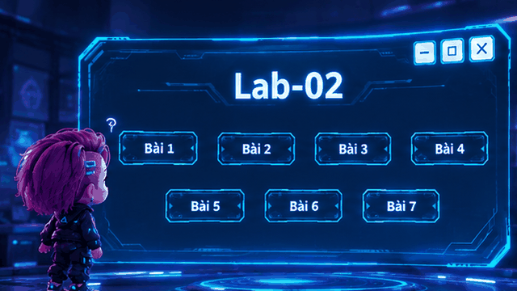

# 🚀 LAB 02 — WINFORMS & DATA PROCESSING SUITE


> [!IMPORTANT]
> **TỔNG QUAN DỰ ÁN**
> 
> **Lab02** là bộ giải pháp phần mềm WinForms đa phân hệ trên nền tảng .NET Framework (Visual Studio 2022 solution `.slnx`). Dự án giải quyết trọn vẹn các bài toán xử lý I/O tập tin văn bản, thuật toán **Dual-Stack** tính toán biểu thức, đóng gói dữ liệu **JSON/SQLite**, giao diện **Frameless Cyberpunk Neon** tích hợp Win32 API & hiệu ứng GIF động, cùng hệ thống báo cáo thống kê chuyên sâu bằng **LINQ**.

---

> [!TIP]
> **✨ ĐIỂM SÁNG NỔI BẬT & ĐIỂM MẠNH KỸ THUẬT**
>
> 1. **🎨 Thiết kế Giao diện Custom (Frameless & Win32 Interop):** 
>    * Loại bỏ hoàn toàn thanh tiêu đề chuẩn của Windows, tự thiết kế nút bấm `[ - ]`, `[ ▢ ]`, `[ X ]`.
>    * Tích hợp trực tiếp thư viện Win32 API `user32.dll` (`ReleaseCapture` & `SendMessage` với `WM_NCLBUTTONDOWN = 0xA1`) giúp nhấp giữ di chuyển Form mượt mà.
>    * Hiệu ứng hình ảnh GIF động (Cuộn phim & Bỏng ngô) được render qua `FrameDimension` kết hợp cơ chế `DoubleBuffered` chống xé hình.
>
> 2. **🧮 Động cơ Thuật toán Dual-Stack (Bài 03):**
>    * Phân tích cú pháp và xử lý tập tin chứa các biểu thức toán học phức tạp đa dòng.
>    * Hỗ trợ đầy đủ toán tử `+`, `-`, `*`, `/`, dấu ngoặc `()` và xử lý thông minh tiền tố số âm dạng `(-X)`.
>
> 3. **📋 Chuẩn hóa Dữ liệu JSON & Regex Validation (Bài 04):**
>    * Mã hóa/giải mã cấu trúc dữ liệu sinh viên bằng engine `System.Text.Json`.
>    * Kiểm soát dữ liệu nghiêm ngặt bằng Biểu thức chính quy:
>      * 🆔 **MSSV:** Đúng 8 chữ số (`@"^\d{8}$"`).
>      * 📞 **SĐT:** Đúng 10 chữ số, bắt đầu bằng số 0 (`@"^0\d{9}$"`).
>
> 4. **🎟️ Đặt Vé Rạp Phim & Báo Cáo LINQ (Bài 05):**
>    * Ma trận ghế tương tác 3 trạng thái màu (Trống / Đang chọn / Đã bán).
>    * Công thức tính giá vé tự động:
>      * 🟡 **Vé Biên (A1, A5, B1, B5, C1, C5):** $50\%$ giá vé chuẩn ($40.000$ VNĐ).
>      * 🔴 **Vé VIP (B2, B3, B4):** $200\%$ giá vé chuẩn ($160.000$ VNĐ).
>      * 🔵 **Vé Thường (Vị trí còn lại):** $100\%$ giá vé chuẩn ($80.000$ VNĐ).
>    * Công cụ thống kê **LINQ Analytics** gom nhóm (`GroupBy`) tính tỷ lệ lấp đầy %, tổng doanh thu và xếp hạng phim.
>
> 5. **🍜 CSDL Quan Hệ SQLite & Query Ngẫu Nhiên (Bài 06):**
>    * Thiết kế mô hình CSDL quan hệ với khóa ngoại `Foreign Key` giữa 2 bảng `MonAn` và `NguoiDung`.
>    * Truy vấn gợi ý món ăn ngẫu nhiên trực tiếp bằng `ORDER BY RANDOM() LIMIT 1`.
>
> 6. **📂 File Explorer TreeView với Lazy Loading (Bài 07):**
>    * Duyệt cấu trúc thư mục đĩa cứng tối ưu RAM nhờ kỹ thuật **Lazy Loading** (dùng gút giả `"dummy"` để chỉ tải thư mục con khi mở rộng nút).

---

## 📖 BẢNG TRA CỨU CHI TIẾT CONTROL & HƯỚNG DẪN THAO TÁC CÁC FORM

### 🎛️ DashBoard — Màn Hình Điều Hướng Trung Tâm
<br>
<table align="center" width="100%">
  <tr>
    <td align="center" width="50%">
      
      <br>
      <sub><b>Giao diện Dashboard</b></sub>
    </td>
    <td align="center" width="50%">
      
      <br>
      <sub><b>Thao tác Chibi High-Tech</b></sub>
    </td>
  </tr>
</table>
<br>

> **Thao tác:** Nhấp chuột vào các nút từ `Bài 1` đến `Bài 7` trên Menu để truy cập trực tiếp Form chức năng.

---

### 📝 Bai01 — Đọc, Mã Hóa & Ghi Tập Tin Văn Bản
> **Thao tác:** Bấm **Đọc File** để nạp `input1.txt` ➔ Sửa nội dung trên khung ➔ Bấm **Ghi File** để chuyển toàn bộ ký tự sang IN HOA và lưu ra `output1.txt`.

| Control Name | Loại Control | Chức năng & Xử lý Kỹ thuật |
| :--- | :--- | :--- |
| `rtbNoiDung` | `RichTextBox` | Hiển thị nội dung đọc được hoặc nhận văn bản nhập từ bàn phím. |
| `btnDocFile` | `Button` | Tìm tệp `input1.txt` theo 3 cấp ưu tiên (Bin ➔ Project ➔ `OpenFileDialog`). |
| `btnGhiFile` | `Button` | Thực thi phương thức `.ToUpper()` và ghi tập tin `output1.txt`. |

---

### 🔍 Bai02 — Phân Tích Thuộc Tính Tệp & Thống Kê Văn Bản
> **Thao tác:** Bấm **Read File** chọn tệp `.txt` ➔ Hệ thống tự động trích xuất các thuộc tính đường dẫn, dung lượng và chỉ số đếm.

| Control Name | Loại Control | Chức năng & Xử lý Kỹ thuật |
| :--- | :--- | :--- |
| `btnRead` | `Button` | Mở `OpenFileDialog` với bộ lọc `.txt`. |
| `rtbContent` | `RichTextBox` | Khung xem toàn văn nội dung tệp. |
| `txtFileName` | `TextBox` | Tên tệp tin ngắn gọn (`SafeFileName`). |
| `txtURL` | `TextBox` | Đường dẫn tuyệt đối của tệp tin trên đĩa cứng. |
| `txtSize` | `TextBox` | Dung lượng tính chính xác theo đơn vị **Bytes** (`FileInfo.Length`). |
| `txtCharCount` | `TextBox` | Tổng số lượng ký tự có trong văn bản. |
| `txtLineCount` | `TextBox` | Tổng số dòng sau khi tách chuỗi `\r\n`. |
| `txtWordCount` | `TextBox` | Đếm số từ chính xác bằng Biểu thức chính quy Regex `@"\b\w+\b"`. |

---

### 🧮 Bai03 — Thuật Toán Dual-Stack Giải Biểu Thức Toán Học
> **Thao tác:** Bấm **Đọc File** ➔ Bấm **Tính Toán** để giải ➔ Bấm **Lưu File** để xuất kết quả (Chỉ mở khóa nút lưu khi 100% biểu thức hợp lệ).

| Control Name | Loại Control | Chức năng & Xử lý Kỹ thuật |
| :--- | :--- | :--- |
| `rtbRead` | `RichTextBox` | Hiển thị danh sách biểu thức đầu vào. |
| `btnCal` | `Button` | Thực thi thuật toán 2 Stack (OpStack & ValStack) tính toán theo độ ưu tiên toán tử. |
| `rtbCal` | `RichTextBox` | Hiển thị danh sách kết quả dạng `[Biểu thức] = [Kết quả]`. |
| `btnSave` | `Button` | Xuất file văn bản mã hóa `UTF-8` bằng `FileStream`. |

---

### 📋 Bai04 — Quản Lý Sinh Viên JSON & Điều Hướng Phân Trang
> **Thao tác:** Nhập dữ liệu bên trái ➔ Bấm **Thêm** ➔ Bấm **Lưu File** để đóng gói JSON ra `input4.txt`. Bấm **Đọc File** để tính ĐTB và xuất `output4.txt`. Bấm **Next** / **Back** để phân trang.

| Control Name | Loại Control | Quy chuẩn Dữ liệu & Ràng buộc (Validation) |
| :--- | :--- | :--- |
| `txtName` / `txtNameRead` | `TextBox` | Họ và tên sinh viên (Bắt buộc nhập). |
| `txtID` / `txtIDRead` | `TextBox` | Mã số sinh viên (**Regex: Đúng 8 chữ số**). |
| `txtPhone` / `txtPhoneRead` | `TextBox` | Số điện thoại (**Regex: Đúng 10 chữ số, bắt đầu bằng 0**). |
| `txtCourse1..3` | `TextBox` | Điểm 3 học phần (Số thực từ `0.0` đến `10.0`). |
| `txtAverageRead` | `TextBox` | Điểm trung bình tự động: $\text{ĐTB} = \frac{\text{Điểm}_1 + \text{Điểm}_2 + \text{Điểm}_3}{3}$. |
| `btnWriteFile` | `Button` | Tuần tự hóa danh sách sang JSON và lưu `input4.txt`. |
| `btnReadFile` | `Button` | Giải tuần tự hóa JSON `input4.txt`, tính ĐTB và xuất `output4.txt`. |
| `btnNext` / `btnBack` | `Button` | Điều hướng con trỏ `currentIndex` để chuyển trang xem chi tiết. |

---

### 🎟️ Bai05 — Hệ Thống Đặt Vé Rạp Phim & Báo Cáo Doanh Thu LINQ

> [!NOTE]
> **QUY TRÌNH THAO TÁC CÁC PHÂN HỆ:**
>
> 1. **Khách đặt vé:** Nhập tên vào `Customer Name` ➔ Click chọn Poster phim ➔ Mở Form `BookingForm` ➔ Chọn phòng chiếu ➔ Click chọn ghế ➔ Bấm **Thanh toán**.
> 2. **Chế độ Quản trị:** Tại góc dưới cùng bên phải Form chọn phim, bấm trực tiếp vào link **`⚙ Quản lý hệ thống`** ➔ Mở Form `PasswordForm` ➔ Nhập mật khẩu `admin123` ➔ Mở Form `AdminForm` ➔ Bấm **Thống kê** xem báo cáo LINQ ➔ Bấm **Lưu** xuất `output5.txt`.

| Form | Control Name | Loại Control | Chức năng & Xử lý Kỹ thuật |
| :--- | :--- | :--- | :--- |
| **`Bai05`** | `txtTenKhachHang` | `TextBox` | Ô nhập tên khách hàng (`Customer Name`). |
| **`Bai05`** | `picDaoPhoPiano`, `picMai`, `picGapLaiChiBau`, `picTarot` | `PictureBox` | Poster 4 phim. Click chuột hoặc dùng phím Tab/Enter để chọn. |
| **`Bai05`** | `lblQuanLyHeThong` | `LinkLabel` | **[LINK GÓC DƯỚI BÊN PHẢI]** Link **`⚙ Quản lý hệ thống`** mở cửa sổ xác thực. |
| **`BookingForm`** | `cbPhongChieu` | `ComboBox` | Chọn phòng chiếu (Rạp 1, 2, 3) để cập nhật ma trận ghế tương ứng. |
| **`BookingForm`** | `pnlGhe` (*Matrix*) | `Panel` / `Button` | Ma trận 15 ghế: **Xám** (Trống), **Xanh lá** (Đang chọn), **Đỏ** (Đã bán). |
| **`BookingForm`** | `lblTinhTien` | `Label` | Tự động tính tiền theo hệ số loại vé ($50\%$, $100\%$, $200\%$). |
| **`BookingForm`** | `btnThanhToan` | `Button` | In hóa đơn, lưu lịch sử vào `input5.txt` và ghi vết ghế vào `booked_seats5.txt`. |
| **`PasswordForm`**| `txtPassword` | `TextBox` | Ô nhập mật khẩu xác thực quản trị (`admin123`). |
| **`AdminForm`** | `btnXuatThongKe` | `Button` | Thực thi **LINQ** `GroupBy` phân tích vé bán, vé tồn, tỷ lệ lấp đầy % và doanh thu. |
| **`AdminForm`** | `btnLuu` | `Button` | Xuất bảng tổng hợp doanh thu ra file `output5.txt`. |

---

### 🍜 Bai06 — Quản Lý Thực Đơn & Quay Số Chọn Món SQLite
> **Thao tác:** Bấm **Thêm** mở `FormNhapLieu` (Thêm Người đóng góp & Món ăn kèm ảnh) ➔ Bấm **Tìm món ăn** mở `FormKetQua` để quay số ngẫu nhiên.

| Form | Control Name | Loại Control | Vai Trò & Truy Vấn CSDL |
| :--- | :--- | :--- | :--- |
| **`Bai06`** | `lvDanhSachMonAn` | `ListView` | Hiển thị bảng món ăn từ truy vấn `SELECT m.IDMA, m.TenMonAn, n.HoVaTen FROM MonAn m LEFT JOIN NguoiDung n ON m.IDNCC = n.IDNCC`. |
| **`FormNhapLieu`**| `txtIDNCC`, `txtHoVaTen`, `cboQuyenHan` | `TextBox` / `ComboBox` | Nhập thông tin Người đóng góp ➔ Lưu vào bảng `NguoiDung`. |
| **`FormNhapLieu`**| `txtIDMA`, `txtTenMonAn`, `cboNguoiDongGop`, `btnChonAnh` | `TextBox` / `Button` | Nhập món ăn mới kèm ảnh ➔ Lưu vào bảng `MonAn`. |
| **`FormKetQua`** | `lblTenMonAn`, `lblNguoiDongGop`, `picKetQua` | `Label` / `PictureBox` | Hiển thị món ăn chọn ngẫu nhiên bằng câu lệnh `ORDER BY RANDOM() LIMIT 1`. |

---

### 📂 Bai07 — Trình Quản Lý Tệp & Thư Mục (File Explorer)
> **Thao tác:** Nhấp chọn từng thư mục trên cây `TreeView`. Nhấp chọn file ảnh (`.jpg`, `.png`, `.jpeg`, `.gif`) để xem nội dung trực tiếp trên `PictureBox`.

| Control Name | Loại Control | Chức năng & Xử lý Kỹ thuật |
| :--- | :--- | :--- |
| `tvFolderBrowser` | `TreeView` | Quét ổ đĩa hệ thống với cơ chế **Lazy Loading** (dùng gút giả `"dummy"`) chỉ nạp cây con khi bấm mở rộng (`BeforeExpand`). |
| `picFileContent` | `PictureBox` | Tự động tải và xem trước nội dung tệp tin ảnh (`AfterSelect`). |

---

> [!WARNING]
> **⚡ HƯỚNG DẪN CÀI ĐẶT & KHỞI CHẠY DỰ ÁN**
>
> 1. **Clone Repository về máy cá nhân:**
>    ```bash
>    git clone https://github.com/thanhnhi8769-ctrl/-NT106.R14-Lab02-25521332.git
>    ```
> 2. **Mở dự án bằng Visual Studio 2022:**
>    * Khởi động Visual Studio 2022 (phiên bản 17.0 trở lên).
>    * Chọn **Open a project or solution** ➔ Chọn tệp giải pháp **`Lab02.slnx`**.
> 3. **Biên dịch & Khởi chạy (Build & Run):**
>    * Nhấn phím `F5` hoặc chọn nút **Start** trên thanh công cụ để chạy ứng dụng từ màn hình `DashBoard`.
